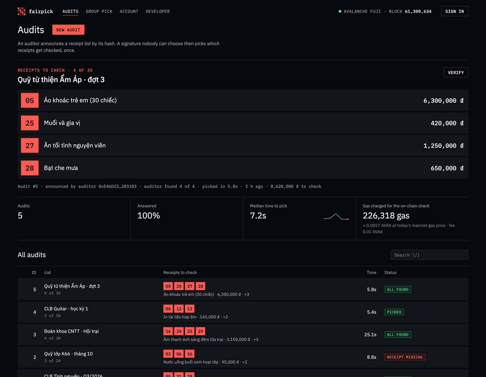
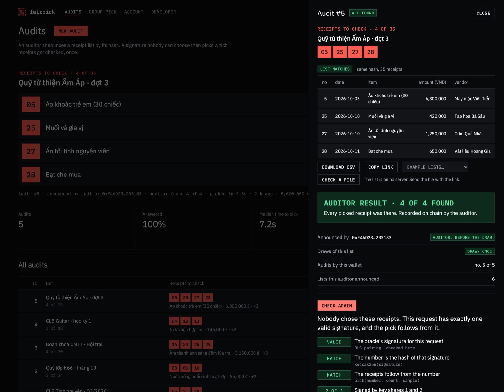
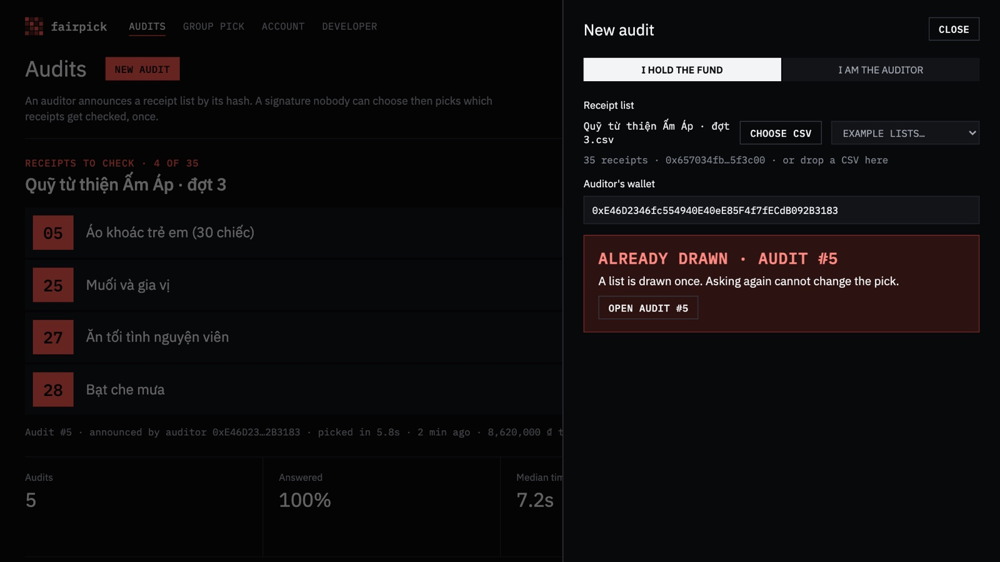
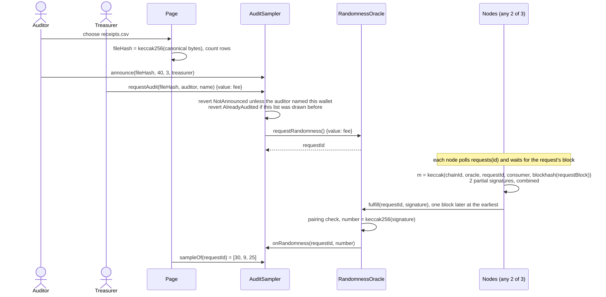

# FairPick

**Slides:** _link goes here before submission_ · **Video (2 to 3 min):** _link goes here before submission_

[](https://github.com/TanHuynh7894/FairPick/actions/workflows/ci.yml)

**FairPick decides which receipts of a club or charity fund get audited, and the treasurer being audited cannot steer the choice.**

The auditor announces the receipt list first and names the one wallet that may request its sample. The sample comes from a threshold BLS signature that nobody can choose, the contract checks that signature with a pairing, and each list gets one sample. Anyone can re-check the result in their browser. Where the randomness comes from: a 2-of-3 threshold BLS signature over the request (commit first, then one draw per list), never `block.timestamp`, `blockhash` alone or `prevrandao`, which a validator or the requester could steer. The receipts themselves stay off-chain; only their hashes and the list commitment go on-chain.

**The audit office runs its own Avalanche L1, `fairpick`, where only wallets it enables can send transactions (TxAllowList). Each audit filed there gets its number from the 2-of-3 oracle on Fuji over ICM, and the L1 checks the oracle's BLS signature before it stores the receipts to check.** The page's *From L1* view lists these audits from public Fuji data ([screenshot](docs/img/l1-view.jpg)); how to check the L1 itself: [l1/](l1/README.md).

| Run (L1 audit) | L1 → Fuji: request delivered on Fuji | Oracle answer on Fuji (2 of 3) | Fuji → L1: answer sent from Fuji | Receipts to check (stored on the L1) |
|---|---|---|---|---|
| 1 · CLB Sách quý 3, 20 receipts | [0x0e8f…9f15](https://testnet.snowtrace.io/tx/0x0e8f1188dab9e5c946c4eb8782b55b71e10830f9d12e14b61d1cdac6dcce9f15) | [0x8d26…1ba7](https://testnet.snowtrace.io/tx/0x8d26c87745141bafde918e18a713154b4f9725c998c1e6360d14272a7b021ba7) | [0x740c…398b](https://testnet.snowtrace.io/tx/0x740c1cec1c9ab0ae21c20ad2d078c9e4f38947c8ae9db800cce4789d4bfa398b) | 13, 12, 4 |
| 2 · Quỹ từ thiện Ấm Áp đợt 3, 35 receipts | [0xb344…49bd](https://testnet.snowtrace.io/tx/0xb34498ca3ed85718d5b0740fec8a5db87a55cd920453bdf250781ee80a2749bd) | [0x8339…9e61](https://testnet.snowtrace.io/tx/0x83398dfd91a7416e672236399a67b0546d65978af4bbe26bfd00a4ba9d9e9e61) | [0x3a4d…69b2](https://testnet.snowtrace.io/tx/0x3a4d7f6c6d7922325faa2b648cd616327d1756ab35de6b108c99f2c9c15d69b2) | 8, 6, 31, 13 |
| 3 · CLB Bóng rổ, 16 receipts, by a treasurer the office had just enabled (after the allow-list) | [0x3153…4d71](https://testnet.snowtrace.io/tx/0x31533ae5b634b9aea663cbf8c18e1ebcbc2a99d14e5b2e9f41dcd2a2af4b4d71) | [0x7611…c3e0](https://testnet.snowtrace.io/tx/0x76111ca4a7bb14b19acc322cb73c2640365d2a427026b71d3df8944bedaec3e0) | [0x1236…055e](https://testnet.snowtrace.io/tx/0x1236e54a850c74b61b1815f97e4d3e681fd722a36c87c221b321dbfdb11f055e) | 5, 14, 1 |
| 4 · Hội SV Kinh tế tháng 11, 22 receipts (after the allow-list) | [0xd24f…8fbf](https://testnet.snowtrace.io/tx/0xd24fc634135229e0102322c0261c22e65b732e35351b069497b3bf4f93b08fbf) | [0x0314…a4be](https://testnet.snowtrace.io/tx/0x0314c3cf1ce69ae6759104807f59404ad07a9d71898f87a8fbd73e37441fa4be) | [0x7e2c…c939](https://testnet.snowtrace.io/tx/0x7e2c927fcf0ad3d56a7e8bd475566a3458138b86e0790ce609d00ab17f40c939) | 18, 15, 3, 6 |

Permissioned writes, on the L1 itself ([log](docs/evidence/l1/permissions.log)): the outsider wallet's audit request is refused by the node (`cannot issue transaction from non-allow listed address`); the audit office enables a new treasurer ([how](scripts/l1-permissions.sh)), which files run 3; after `setNone` the same wallet is refused again.

- **Live on Avalanche Fuji, verified on Routescan:** [RandomnessOracle](https://testnet.snowtrace.io/address/0xa4c1019b76EE5bEB9aFe641AAcf164b787b037Dd) · [AuditSampler](https://testnet.snowtrace.io/address/0x415eaC3a64111E68DB8136660CD7Ff06F9F4f654) · [RandomnessBeacon](https://testnet.snowtrace.io/address/0x60198D44a183d313B5EAa432F85D184cab9F217C). Five audits answered by 2 of 3 key shares, for example [audit #1](https://testnet.snowtrace.io/tx/0x072590f9e294a95658ec0845ee0812d3a19f88a66ce197d14e6d91a553d21dc3). Every transaction is linked [below](#sample-audits-executed-on-fuji).
- 311 tests pass: 136 Solidity (18 of them for the ICM pair), 49 node, 126 dashboard ([commands](#tests)).
- Built from 2 Nov 2026 for Team1 Vietnam UniHack 2026 by team Zillexa.



> **Tóm tắt.** FairPick chọn ngẫu nhiên những hoá đơn của quỹ CLB hoặc quỹ từ thiện cần kiểm tra, và người giữ quỹ không thể tự chọn mẫu. Kiểm toán viên công bố trước danh sách (chỉ hash và số dòng lên chain), thủ quỹ gửi yêu cầu, 2 trong 3 node ký BLS, hợp đồng kiểm chữ ký bằng pairing rồi tính ra các số thứ tự hoá đơn. Mỗi danh sách chỉ được chọn mẫu một lần. Không ai được lợi khi bị chọn: con số ngẫu nhiên chỉ quyết định hoá đơn nào được xem. Chạy trên Avalanche Fuji (testnet), phí bằng AVAX test, số tiền trong hoá đơn tính bằng VND.

A student club spends 79.8 million VND on a volunteer trip and keeps 40 receipts. Nobody checks all 40, so someone picks a few. If the treasurer selects the sample, they can leave out the receipts that would not survive a check. In FairPick the auditor announces the list by its hash and receipt count, for the treasurer's wallet. The treasurer then requests the sample, two of three oracle nodes sign the request, and the signature decides it: *check receipts 5, 21 and 28* ([audit #1 on Fuji](https://testnet.snowtrace.io/tx/0x072590f9e294a95658ec0845ee0812d3a19f88a66ce197d14e6d91a553d21dc3)). The contract checks the signature on chain, and the page checks it again with no server in between.

Nobody gains anything from a pick. The contracts pay nobody who is selected, and the random number only decides which receipts an auditor looks at. The same oracle fits other selections where being picked brings no gain:

- randomized inspection of any list (the AuditSampler, built and live);
- picking a committee, a jury or reviewers from a member list (Group pick on the beacon, built and live);
- assigning tasks or duty rotas (not built).

The receipt list never leaves the browser. On chain go its hash, its receipt count and a short public name.

**Keywords:** verifiable audit sampling · auditor announces the receipt list first (commitment), one draw per list · 2-of-3 threshold BLS randomness checked on-chain (VRF-style), not `block.timestamp` or `prevrandao` · receipts stay off-chain, only hashes on-chain · club and charity fund transparency · no prizes, no payouts · own Avalanche L1 `fairpick` · ICM / Teleporter · TxAllowList · Avalanche Data API · Fuji

## Live on Avalanche Fuji

All three contracts are verified on Routescan, the explorer behind testnet.snowtrace.io. Oracle and sampler were deployed on 19 Nov 2026 (block 61,295,475), when the auditor's announcement was added; the beacon is unchanged.

| Contract | Address | What it does |
|---|---|---|
| RandomnessOracle | [`0xa4c1019b76EE5bEB9aFe641AAcf164b787b037Dd`](https://testnet.snowtrace.io/address/0xa4c1019b76EE5bEB9aFe641AAcf164b787b037Dd) | Takes a fee, accepts a BLS signature for a request, checks it with a pairing. Stores how its key is split: `threshold()` = 2, `shareCount()` = 3 |
| AuditSampler | [`0x415eaC3a64111E68DB8136660CD7Ff06F9F4f654`](https://testnet.snowtrace.io/address/0x415eaC3a64111E68DB8136660CD7Ff06F9F4f654) | Takes the auditor's announcement (list hash, count, sample size, the one wallet that may request), refuses every other requester and a second draw, turns the oracle's number into a sample, stores the auditor's result |
| RandomnessBeacon | [`0x60198D44a183d313B5EAa432F85D184cab9F217C`](https://testnet.snowtrace.io/address/0x60198D44a183d313B5EAa432F85D184cab9F217C) | Group pick with no node: commit-reveal with deposits, optionally limited to a member list |

### What runs on Fuji, exactly

- The 2-of-3 threshold code was written on the `feat/threshold` branch (13 Nov) and merged into `main` on 18 Nov. The live oracle was deployed from `main` on 19 Nov and reports `threshold()` = 2 and `shareCount()` = 3. Earlier oracles with one full key are superseded and not linked here.
- Three node processes, started by `scripts/fuji-nodes.sh`. Each holds one share of the oracle's BLS key and pays gas from its own wallet. Any two can answer. One alone cannot.
- All three run on one laptop and talk over `127.0.0.1`. They are three processes, not three operators.
- The key was made by one dealer (`scripts/fuji-keygen.sh`) and split at creation. The full key was never written to disk, but the program that made it held it in memory. There is no distributed key generation.
- The lists below were announced by an auditor wallet (`0xE46D…3183`) and requested by a treasurer wallet (`0x7588…Fd95`). Neither is the fee-receiving operator (`0x8e19…Fa75`) or a node wallet. A third wallet (`0x9850…B371`) played the stranger. All these wallets belong to the team. The receipt lists are invented sample data, and so are the auditor's results.

### Sample audits executed on Fuji

| Audit | Request | Answer | Signed by | Receipts to check | Auditor's result |
|---|---|---|---|---|---|
| #1 CLB Tình nguyện · Q3/2026, 3 of 40 | [0xd1510b91…](https://testnet.snowtrace.io/tx/0xd1510b91006780dd3f9ad8902b72befd81a24ae625bcf5853fa8709483ed6d6c) | [0x072590f9…](https://testnet.snowtrace.io/tx/0x072590f9e294a95658ec0845ee0812d3a19f88a66ce197d14e6d91a553d21dc3) | shares 1 + 2, all nodes up | 5, 21, 28 | all found |
| #2 Quỹ lớp K66 · tháng 10, 3 of 24 | [0xf1e70157…](https://testnet.snowtrace.io/tx/0xf1e70157fe11dc73edb3c774a24267d948eca5ed47465e09e63f4edeb4168b77) | [0x5e69dbeb…](https://testnet.snowtrace.io/tx/0x5e69dbeb80b4a541cf7515135545ec0b5f9e70d1b5cd88477271d035a78aecbe) | shares 2 + 3, node 1 stopped | 3, 6, 16 | 1 not found |
| #3 Đoàn khoa CNTT · Hội trại, 4 of 30 | [0x7432d771…](https://testnet.snowtrace.io/tx/0x7432d771323d7677d8c94ddb2d09eef65bec885248b53b5e662a6c05f73ddbb2) | [0x781a0219…](https://testnet.snowtrace.io/tx/0x781a02193291af057f34393a37483069a718f0ec3a07529845a2d5a740894729) | shares 1 + 2. Node 1 was alone first and could not answer | 16, 20, 25, 29 | all found |
| #4 CLB Guitar · học kỳ 1, 3 of 18 | [0x4112fee3…](https://testnet.snowtrace.io/tx/0x4112fee3ce232c96752875c50978f96b54feae08ee85b4026fbfd2300b4598b5) | [0xe80ffa3d…](https://testnet.snowtrace.io/tx/0xe80ffa3d3b900a35a48d8800f015e813f721353d73c34dab61f26f38f457c7a8) | shares 1 + 2, all nodes up | 4, 12, 13 | not recorded |
| #5 Quỹ từ thiện Ấm Áp · đợt 3, 4 of 35, requested from the page | [0xeec9587d…](https://testnet.snowtrace.io/tx/0xeec9587d7e5cf2f4469565f9b67e75cf7d60794f86fa52b9db1c3920d8024c6a) | [0xa12b42fb…](https://testnet.snowtrace.io/tx/0xa12b42fbb55409973144d0023fadbe90353abd39020d95e26e41a0c49ecb90d6) | shares 1 + 2, all nodes up | 5, 25, 27, 28 | all found |

Two refusals, both on the list of audit #1:
- The stranger wallet asked for its draw: [0x8b00740f…](https://testnet.snowtrace.io/tx/0x8b00740f870ef3c2f8f15a81bc87f5390c1abce1da8a4c8e69b6346eadd3709e) reverted. The auditor had announced that list for the treasurer only (`NotAnnounced`). Before this deployment, anyone who knew a list's hash could use up its only draw.
- The treasurer asked a second time: [0x8d7cb803…](https://testnet.snowtrace.io/tx/0x8d7cb80330de326e64ab3484091c27714d58ab65d4df7c25db3e6c47e343d446) reverted with `AlreadyAudited(1)`.

Check any of it yourself:

```sh
SAMPLER=0x415eaC3a64111E68DB8136660CD7Ff06F9F4f654 RPC=https://api.avax-test.network/ext/bc/C/rpc
AUDITOR=0xE46D2346fc554940E40eE85F4f7fECdB092B3183 LIST=0xb54d0d8ecdc16be01c8e274c34105c35bd8e7ff30edf8230d47ba9c579b77457
cast call $SAMPLER 'sampleOf(uint256)(uint32[])' 1 --rpc-url $RPC      # [28, 21, 5]: draw order. The page sorts them.
cast call $SAMPLER 'announcements(address,bytes32)(address,uint32,uint16)' $AUDITOR $LIST --rpc-url $RPC   # the treasurer, 40, 3
cast call $SAMPLER 'auditOfList(bytes32)(uint256)' $(cast call $SAMPLER 'listKey(address,bytes32)(bytes32)' $AUDITOR $LIST --rpc-url $RPC) --rpc-url $RPC   # 1
(cd node && npm ci && npm run list-hash -- ../examples/receipts-clb-tinh-nguyen-q3-2026.csv)   # the same hash, 40 receipts
(cd node && npm run check-partials -- ../docs/evidence/audit-2.json)   # which key shares signed audit #2 (files for #1 to #5)
```

`check-partials` reads the oracle's public key, threshold and share keys from the contract and takes only the partial signatures from the file. A pass shows that the answer is the combination of two signatures, each valid under a different share key the oracle was deployed with. It cannot show where those shares are kept, or that nobody holds the whole key: whoever split the key knew all of it. The node logs behind these files are in [docs/evidence/logs](docs/evidence/logs): wallet addresses, partial-signature counts and transaction hashes, no keys.

### Measured on Fuji (19 Nov 2026)

| | Gas charged (from the receipts above) | At the C-Chain mainnet base fee, 7.5 nAVAX |
|---|---|---|
| Auditor announces a list | 53,851 (70,951 for the auditor's first) | 0.0004 AVAX |
| Treasurer requests the draw | 229,275 to 273,929 | 0.0017 to 0.0021 AVAX |
| Answer: BLS pairing check plus callback | 226,318 to 235,555 | 0.0017 to 0.0018 AVAX |
| Auditor records the result | 31,368 to 31,380 | 0.0002 AVAX |
| Oracle fee per audit | | 0.01 AVAX, about six times the answer's gas |

- Avalanche bills a transaction at least half its gas limit (ACP-194): the two refused requests above had a 200,000 limit and were charged exactly 100,000. The nodes now set the limit at 102% of the estimate. The estimate includes the 200,000 gas the oracle keeps free for the callback, so the limits were 414,558 to 423,607, and half of that stays below what an answer uses. The answer column is therefore real use. On the previous deployment the nodes added 30%, and every answer was billed exactly half its limit, 264,141 to 264,283.
- The Fuji transactions paid 160 wei per gas: a 10 wei base fee plus a 150 wei tip. That makes Fuji costs meaningless (about 0.00000000004 AVAX per answer), so the right column prices the same gas at mainnet's base fee, read with `cast base-fee --rpc-url https://api.avax.network/ext/bc/C/rpc`.
- Request to answer, with all three nodes up: 3, 6 and 4 blocks, 7.2 s, 5.4 s and 5.8 s by block timestamps (audits #1, #4, #5). With node 1 stopped: 8 blocks, 8.8 s (#2). Audit #3 took 10 blocks and 25.1 s because nodes 2 and 3 were held back on purpose; node 1 logged "1 of 2 partial signatures" nine times until it came up. The time is the node's 1.5 s poll, a few RPC round trips and Fuji's blocks. An answer cannot land in the request's own block: `fulfill` refuses it.
- 5 of 5 requests answered.

## What you can do in the app



1. Audits: the latest audit leads with the receipts to check: number, item, amount in VND. Below it, every audit. From L1: the audits filed on the audit office's L1, read from Fuji, with the L1's record checked against the oracle's answer.
2. New audit, in two parts. The auditor (`I AM THE AUDITOR`) picks the CSV, the sample size and the treasurer's wallet, and sends `announce(hash, count, sampleSize, treasurer)`. The treasurer (`I HOLD THE FUND`) picks the same CSV and sends `requestAudit(hash, auditor, name)` with the oracle fee. A list from another wallet, a list nobody announced, a changed file and a list already drawn are each refused in a full-width red banner, the last with a link to its audit.

   
3. Verify: on any audit the browser repeats the contract's checks: the BLS pairing (VALID), `keccak256(signature) == number` (MATCH), the sample recomputed from that number (MATCH). With the nodes reachable it also shows which two key shares signed, checked against the share keys in the oracle. The sheet says who announced the list, how many times it was drawn and how many audits the requester has.
4. Record the result: the auditor marks which picked receipts were not found, once, on chain. The audit then reads ALL FOUND or RECEIPT MISSING.
5. Check the list: anyone holding the file loads it into the audit. The page says whether its hash and its receipt count are the committed ones. The treasurer downloads the committed bytes and sends them with the audit's link. A copy somebody was sent can be dropped on the sheet and is checked the same way.
6. Group pick, with no node: a committee makes a seed together by commit-reveal. The same pick rule then turns the seed into, say, 3 members out of 12. A round can be limited to listed members.
7. Account, Developer and Admin: your audits and refunds; a sample consumer contract and a command line; for the operator wallet, fees, gas cost per answer, node wallets and books that must balance.

Reading needs no wallet. The page finds answer transactions through the Avalanche Data API and falls back to RPC logs.

## How it works



- A request has one valid answer. A message has exactly one valid BLS signature under a given key. `BLS.sol` hands the pairing precompile the signature as two field elements, and the precompile rejects values at or above the field prime and points off the curve, so there is also only one encoding. The nodes cannot try several answers and keep the one they like. They can only answer or stay silent. A request nobody answers expires after 256 blocks and the fee is refunded.
- The auditor fixes the list before the draw. `announce` stores the file hash, the receipt count, the sample size and the one wallet whose `requestAudit` will be accepted. It cannot be changed, and the same auditor cannot announce the same hash twice. Nobody else can use up the draw by knowing the hash, and a treasurer cannot draw edited or re-ordered copies the auditor never announced. A treasurer who is their own auditor is allowed, and the page says so.
- A list is drawn once. The draw is keyed by auditor and file hash, and a second request reverts with `AlreadyAudited`. The only way to a further draw is one that got no answer and was refunded. It is numbered on chain (`draw` 2, 3, …) and the page shows it.
- The receipt count is committed with the hash. `commitment(fileHash, itemCount)` is one value for both. A file with 45 rows does not match a commitment made with a count of 40, and the page says so in red.
- Two of three nodes sign. The key is split 2 of 3 with Shamir's scheme. Nodes exchange partial signatures and combine them with Lagrange coefficients. The oracle stores the three share public keys and refuses to deploy unless any two of them make up its public key.
- The pick is a fixed rule. Draw *i* is `keccak256(abi.encode(seed, i, try)) mod itemCount + 1`, retried on a repeat. The same rule exists in Solidity (`AuditSampler.pick`) and TypeScript (`pickSample`), and a test checks they agree on chain.

Diagrams for the other flows, the state machines and the threat model are in [docs/ARCHITECTURE.md](docs/ARCHITECTURE.md).

### The list hash

The hash is `keccak256` of the file's canonical bytes: UTF-8, no byte-order mark, LF line ends, no newline at the end. Excel's "CSV UTF-8" adds a byte-order mark and CRLF, editors add or drop the last newline, and none of that changes the hash. A changed character inside the list does. The receipt count is the number of non-blank lines after the header. `npm run list-hash` in `node/` prints the same values as the page.

A spreadsheet that re-saves the file with other quoting or separators produces a different list. So the auditor should get the committed file itself: `DOWNLOAD CSV` in the audit sheet saves exactly the hashed bytes, and `COPY LINK` gives `…/#oracle/<id>`. The list is kept only in the treasurer's browser storage. If it is lost, the audit still stands but nobody can show the picked rows.

## Why Avalanche

What is specific to this chain, in the order we rely on it:

1. The answer is final a block later. The signed message contains the hash of the request's block, which nobody knew when the request was sent. On Avalanche an accepted block is final in about a second ([docs](https://build.avax.network/docs/primary-network/exchange-integration)), so that hash cannot be reorganised away to get another draw, and a node may answer as soon as the request's block is accepted instead of waiting out a reorg depth. Measured, answers landed 3 to 6 blocks after the request (5.4 to 7.2 s), mostly the node's poll interval and RPC round trips. The whole 256-block answer window is a few minutes (blocks came every 1.4 s on Fuji and 0.75 s on mainnet over the last 1,000 blocks when we measured).
2. Checking every audit on chain is cheap enough to charge for. The pairing check plus callback was charged 226,318 to 235,555 gas, its real use, 0.0017 to 0.0018 AVAX at today's mainnet base fee. The 0.01 AVAX fee covers it about six times. The table above links the receipts.
3. The page reads through the Avalanche Data API. Public Avalanche RPCs cap `eth_getLogs` at 100 blocks per request, counted across a whole batch. One call to `data-api.avax.network` lists the oracle's transactions at any age, with who sent each answer and the gas it used (`dashboard/src/answers.ts`). RPC logs remain the fallback, and the only path on a local chain.
4. It can move to an Avalanche L1 without waiting for anyone. The contracts need only the standard precompiles `0x05` to `0x08`. `RPC_URL=https://subnets.avax.network/dispatch/testnet/rpc ./scripts/fuji-smoke.sh` runs the BLS checks and an oracle deployment by `eth_call` on the Dispatch L1 and passes; the same holds for Echo. Chainlink VRF, the usual alternative, is offered on the C-Chain but on no Avalanche L1 ([supported networks](https://docs.chain.link/vrf/v2-5/supported-networks)). It now does: the audit sampler runs on our own L1 and reaches the oracle over ICM ([below](#own-l1-fairpick-and-icm)).

## Own L1 `fairpick` and ICM

Own Avalanche L1 `fairpick` (chainId 510103, blockchainID `24ttXXTxYDu7QNNMbdMkmjiZkBB5zYN5qQikNWTr3REqcibFYg`, subnetID `xhPrD6175hcsC8WRTb1e64c7agEkcBmkLA1YFtuTVxi42dXmj`) live on Fuji since 21/11. Validator on a team laptop, RPC local, P-Chain proof: `curl -s -X POST -H 'content-type:application/json' --data '{"jsonrpc":"2.0","id":1,"method":"platform.getSubnet","params":{"subnetID":"xhPrD6175hcsC8WRTb1e64c7agEkcBmkLA1YFtuTVxi42dXmj"}}' https://api.avax-test.network/ext/bc/P` (shows `managerChainID` = the L1).

**Why an L1.** A club or charity federation runs one audit office for all its member funds. On its own chain (`fairpick`, token FPK) the office decides who may write: only treasurers and auditors it has enabled, and the ICM relayer, can send transactions (TxAllowList precompile, [l1/](l1/README.md)), so a stranger cannot file audits under a fund's name or spam the sampler, which a contract on Fuji cannot prevent. They pay gas in FPK instead of AVAX, and the office runs the validator. A validator that also produces the blocks could pick block contents until a blockhash gives a sample it likes, so the L1 does not make its own randomness: it asks the 2-of-3 BLS oracle on Fuji over ICM and checks the answer itself.

| Chain | Contract | Address |
|---|---|---|
| fairpick L1 (510103) | `L1AuditSampler`: announce, request (sends ICM), receive the answer, check BLS, store the sample | `0x3A54a96d74891C3d8E707760A60A1Ef96e07f7dF` |
| Fuji C-Chain | `IcmRandomnessAdapter`: receive the request, file it with the oracle and pay its fee, send the answer back | [`0x1C2ee9B10369F8459F07A933590598C6076E11CE`](https://testnet.snowtrace.io/address/0x1C2ee9B10369F8459F07A933590598C6076E11CE) (verified) |
| Fuji C-Chain | `RandomnessOracle` (unchanged, the live one above) | [`0xa4c1019b76EE5bEB9aFe641AAcf164b787b037Dd`](https://testnet.snowtrace.io/address/0xa4c1019b76EE5bEB9aFe641AAcf164b787b037Dd) |

Both sides use the TeleporterMessenger at `0x253b2784c75e510dD0fF1da844684a1aC0aa5fcf` with zero fee; the team's relayer delivers. Each receiver accepts a message only from the messenger, from the other chain's blockchainID and from the one contract named at setup (set once, then fixed).

What goes over ICM, and why:
- **L1 → Fuji** `(auditId, commitment)`: the request. The adapter calls `requestRandomness` and pays the 0.01 AVAX oracle fee from a balance the audit office prepays, so nobody on the L1 needs AVAX.
- **Fuji → L1** `(auditId, oracleRequestId, requestBlockHash, signature)`: the answer. The L1 rebuilds the message the nodes signed (`keccak256(43113, oracle, requestId, adapter, requestBlockHash)`), checks the signature against the oracle's public key with the BN254 pairing precompile, takes `keccak256(signature)` as the seed and stores the picks (same rule as `AuditSampler.pick`, fuzz-tested to agree). An oracle answer settles one audit at most.

The forward step on Fuji (`adapter.forward(requestId, signature)`) is open to anyone, because the signature must hash to the number the oracle stored; `scripts/icm-audit.sh` takes it from the nodes' `fulfill` transaction.

All transactions of the four runs, 3 and 4 after the allow-list was switched on (L1 hashes are on the local RPC; the Fuji deliveries carry Warp messages signed by the L1's validator):

| Step | Run 1 (audit 1, oracle request 6) | Run 2 (audit 2, oracle request 7) | Run 3 (audit 3, request 8, new treasurer) | Run 4 (audit 4, request 9) |
|---|---|---|---|---|
| L1 `announce` | `0x2cf8a1721c63635f6942534fe88c5797da10c85905941d2cc4e79674edb1b1c3` | `0x780692e64c0a9742261289cced7034f685b9d3ef5a8abc03ecffdac3cc208c13` | `0x857f9b371843298661d00ef258209fe847b4b2f6400e68ca6f6c67b9a4bff4a9` | `0x84f0fad56a6846258a87ee2243fddcd5db6f437213cb4516751f5893512b36e0` |
| L1 `requestAudit`, ICM send | `0x8ac6e59be1535afc940e91f5e6f0b0dd8080fba0dd8490139d0157ccd2ff4d7e` | `0x1bd820652cb6d95c226054908fd001b0fcb6b824058bc6a13c8f5c3bfd96e2f9` | `0x23d2a972dd35624ea208048d6f32721b9e295422ec28316f1f30921c55a99dfd` | `0x0eeaee778a18e2b5ef931d8c3bce00751ef19c91e7ad4fc93fd9f575c43179cb` |
| Fuji ICM receive (`MessageExecuted`), oracle request filed | [0x0e8f1188…9f15](https://testnet.snowtrace.io/tx/0x0e8f1188dab9e5c946c4eb8782b55b71e10830f9d12e14b61d1cdac6dcce9f15) | [0xb34498ca…49bd](https://testnet.snowtrace.io/tx/0xb34498ca3ed85718d5b0740fec8a5db87a55cd920453bdf250781ee80a2749bd) | [0x31533ae5…4d71](https://testnet.snowtrace.io/tx/0x31533ae5b634b9aea663cbf8c18e1ebcbc2a99d14e5b2e9f41dcd2a2af4b4d71) | [0xd24fc634…8fbf](https://testnet.snowtrace.io/tx/0xd24fc634135229e0102322c0261c22e65b732e35351b069497b3bf4f93b08fbf) |
| Fuji `fulfill` by 2 of 3 nodes | [0x8d26c877…1ba7](https://testnet.snowtrace.io/tx/0x8d26c87745141bafde918e18a713154b4f9725c998c1e6360d14272a7b021ba7) | [0x83398dfd…9e61](https://testnet.snowtrace.io/tx/0x83398dfd91a7416e672236399a67b0546d65978af4bbe26bfd00a4ba9d9e9e61) | [0x76111ca4…c3e0](https://testnet.snowtrace.io/tx/0x76111ca4a7bb14b19acc322cb73c2640365d2a427026b71d3df8944bedaec3e0) | [0x0314c3cf…a4be](https://testnet.snowtrace.io/tx/0x0314c3cf1ce69ae6759104807f59404ad07a9d71898f87a8fbd73e37441fa4be) |
| Fuji `forward`, ICM send | [0x740c1cec…398b](https://testnet.snowtrace.io/tx/0x740c1cec1c9ab0ae21c20ad2d078c9e4f38947c8ae9db800cce4789d4bfa398b) | [0x3a4d7f6c…69b2](https://testnet.snowtrace.io/tx/0x3a4d7f6c6d7922325faa2b648cd616327d1756ab35de6b108c99f2c9c15d69b2) | [0x1236e54a…055e](https://testnet.snowtrace.io/tx/0x1236e54a850c74b61b1815f97e4d3e681fd722a36c87c221b321dbfdb11f055e) | [0x7e2c927f…c939](https://testnet.snowtrace.io/tx/0x7e2c927fcf0ad3d56a7e8bd475566a3458138b86e0790ce609d00ab17f40c939) |
| L1 ICM receive (`MessageExecuted`), BLS checked, sample stored | `0xd9b8ef3841ccee040b03e9c7a477276d8f029e4ea7f210d22a341995eda65442` | `0x42f70713430382787f8768b226812110e59934ac06e6747204d68da07dc1126c` | `0xdd2680375da0d62286cca90c8007d4fcbdaf43b43e8be09cf4a4e9cd5564dd93` | `0x04ea3069582b5bda1ac0f6e24e64984b0bade98a90628f4b084f578a9b3c9a55` |
| Receipts to check | 13, 12, 4 of 20 | 8, 6, 31, 13 of 35 | 5, 14, 1 of 16 | 18, 15, 3, 6 of 22 |

A round trip took 20 to 26 s from the L1 request being mined to the sample stored on the L1. The L1 receive used 646,212 gas (pairing check included). Run logs: [docs/evidence/icm](docs/evidence/icm), run 3 in [docs/evidence/l1](docs/evidence/l1/permissions.log). Deployment: `scripts/icm-deploy.sh`. One run: `scripts/icm-audit.sh <receipts.csv> <how many> <name>`, with the oracle nodes running.

Limits ([details](l1/README.md#limits)): one validator on a team laptop, PoA with team keys as validator-manager owner and allow-list admins, RPC on localhost, a P-Chain balance topped up daily. An oracle request never answered lets the adapter `reclaim` the fee, but the L1 audit stays open. The page sees the L1 only through Fuji plus a record exported from the L1 (`scripts/l1-export.sh`), which it checks against Fuji.


## Who else does this

| | What it is | Why FairPick does not just use it |
|---|---|---|
| Excel `RAND()` by the treasurer | What clubs do today | The person being checked chooses, and can re-roll in private |
| [Chainlink VRF v2.5](https://docs.chain.link/vrf/v2-5/supported-networks) | Live on Fuji and C-Chain mainnet (Fuji coordinator `0x5C21…7BEE`), in production use, run by an independent network, paid in LINK or AVAX | It is the stronger choice for trust in the operator, and FairPick's sampler could consume it on the C-Chain. It does not exist on an Avalanche L1. The requester must fund a subscription or the consuming contract. Its proof is not something the page re-checks in a browser. We did not run a side-by-side measurement |
| RANDAO (`block.prevrandao`) | Ethereum's built-in per-block randomness | On Avalanche it is the constant 1, on Fuji and on C-Chain mainnet: an `eth_call` of the bytecode `0x4460005260206000f3` (PREVRANDAO, return it) returns `…0001` on both. On Ethereum it is also biasable by the proposer, who can skip a slot |
| [drand](https://www.drand.love/loe) | Free public beacon run by the League of Entropy, a new value every 3 s | The default network signs on BLS12-381, and the C-Chain has no BLS12-381 precompiles ([docs](https://build.avax.network/docs/rpcs/other/standards/cryptographic-primitives)). drand's BN254 network, [evmnet](https://docs.drand.love/blog/2025/08/26/verifying-bls12-on-ethereum), could be verified by `BLS.sol`. A round's value is public to everyone at once, so an audit would have to commit to a future round and someone would have to bring it on chain. Not built |
| Random UChile for Chile's Comptroller | A [prototype](https://revistasdex.uchile.cl/index.php/bits/article/view/15257) that selected public employees to audit from a public beacon | Same idea, for a state auditor. NIST lists ["select random government officials for financial audits"](https://csrc.nist.gov/projects/interoperable-randomness-beacons/apps) as a beacon use |

Random selection is what auditing standards ask of a statistical sample ([ISA 530](https://iaasa.ie/wp-content/uploads/2022/11/ISA-530_Oct_2022.pdf), paragraph 5(g)). What FairPick adds is who gets to do the selecting, and that it happens once.

## Who pays, and why now

- The likely payer is a fund. Under [Decree 93/2021/NĐ-CP](https://luatvietnam.vn/tai-chinh/nghi-dinh-93-2021-nd-cp-tiep-nhan-va-su-dung-nguon-dong-gop-tu-nguyen-ho-tro-thien-tai-dich-benh-benh-nhan-mac-benh-hiem-ngheo-211653-d1.html), individuals who raise voluntary contributions must open a separate account for each campaign (Article 17.2), and organisations and individuals must publish what came in and what was spent (Articles 14 and 19). Student clubs and class funds have the same problem at a smaller scale and no rule at all.
- Bank statements are already public: MB's Thiện Nguyện app publishes them automatically and reports over 2 million users and more than 7,750 campaigns ([The Investor, Sept 2025](https://theinvestor.vn/from-transparent-technology-to-humanitarian-values-the-story-of-vietnams-first-charity-platform-d16954.html)). A statement shows that money left the account, not what it was spent on. Two widely reported disputes in 2025 show the limits of disclosure: in [one](https://24hmoney.vn/news/vu-tu-thien-do-pham-thoai-keu-goi-16-7-ty-bi-rut-chi-con-hon-54-trieu-ma-khong-he-co-thong-bao-mbbank-noi-gi-c26a2521540.html), donors saw large withdrawals from the campaign account with no notice of what they paid for; in [the other](https://znews.vn/toan-canh-on-ao-vu-nuoi-em-post1609233.html) (Nuôi Em), the questions were duplicate sponsorship codes, money collected in a personal account and missing updates. Neither was about forged receipts, and in both, police later found no crime ([one](https://danviet.vn/pham-thoai-len-tieng-sau-khi-cong-an-khanh-hoa-cong-bo-ket-qua-dieu-tra-vu-lum-xum-tien-tu-thien-d1350234.html), [two](https://baovanhoa.vn/doi-song/bo-cong-an-du-an-nuoi-em-khong-co-dau-hieu-toi-pham-223340.html)). A [draft from the Ministry of Finance](https://baochinhphu.vn/de-xuat-moi-ve-van-dong-tiep-nhan-phan-phoi-su-dung-cac-nguon-dong-gop-tu-nguyen-thuc-hien-hoat-dong-xa-hoi-tu-thien-102261112174610259.htm) (12 Nov 2026) would require publishing figures at least every 7 days.
- A fund would pay for one audit: a pick it could not have steered, which it can show to donors. The cost floor is the answer's gas, about 0.0017 AVAX at mainnet prices. A real service would bill in VND off chain.
- No fund or club has used it. The price is not validated with anyone. The audit itself, someone looking at the picked receipts, stays manual and outside FairPick.

## Why on chain, why Avalanche, money, Vietnamese law

| Question | Answer |
|---|---|
| Does anyone gain from a pick? | No. A pick decides which receipts an auditor checks. Nobody receives money or goods. In a group pick each member gets their own deposit back after revealing; a member who does not reveal leaves theirs in the contract, and nobody else receives it. An earlier version of this repo demonstrated the oracle with a dice example. It was removed on 18 Nov because the rules ban dice, and the oracle was redeployed, so the live contract has only audit requests. |
| Why on chain? | The pick has to be fixed before the treasurer can react, and checkable by people who trust neither the treasurer nor the operator. The contract enforces the order: the list's hash first, then the signature check, then the sample, and one draw per list. The record cannot be edited afterwards. |
| Why Avalanche? | See [Why Avalanche](#why-avalanche): final a block later, about 0.0017 AVAX per on-chain check at mainnet prices, reads through the Avalanche Data API, and a path to an L1 where Chainlink VRF does not exist. |
| Where does the money come from? | The requester pays a flat oracle fee (0.01 test AVAX, fixed when the oracle was deployed). It goes to the operator address and covers the nodes' gas. There is no token, no yield and no fundraising. Group picks take no fee. |
| Who controls the contracts? | Nobody can change them. The oracle has one role, `operator`: the address that receives the fees of answered requests. `withdraw()` can be called by anyone and always pays the operator. There is no owner, no pause, no upgrade and no key rotation. A new key or fee means a new deployment. |
| Custody | Non-custodial. The contracts hold only pending fees and deposits. Each address can withdraw only its own refunded fees and its own deposit. An invariant test checks that the oracle always holds what it owes. |
| Agents | The node is a fixed program with no model in it. It answers every request whose signature it can produce, and nothing else. It never offers more gas money for one answer than the oracle's fee (`MAX_ANSWER_COST_WEI`) or more than 500 gwei per gas (`MAX_FEE_GWEI`), and raises a transaction's fee by 25% each time it has been stuck for 30 s, up to those caps. No LLM is used anywhere in the product. |
| Personal data | On chain go a hash, counts and a short public name. Receipts stay in the treasurer's browser, in line with Vietnam's Personal Data Protection Law (Law 91/2025/QH15, in force since 1 Jan 2026). |
| Vietnamese law | Crypto is not a lawful means of payment in Vietnam ([State Bank of Vietnam](https://vnba.org.vn/vi/bitcoin-khong-phai-tien-phap-quy--khong-phai-la-phuong-tien-thanh-toan-hop-phap-tren-dat-nuoc-viet-nam-6822.htm)), and the crypto-asset pilot requires offering, trading and payment in VND ([Resolution 05/2025/NQ-CP](https://luatvietnam.vn/linh-vuc-khac/nghi-quyet-05-ve-tai-san-so-tong-hop-6-noi-dung-dang-chu-y-883-104054-article.html)). FairPick does not use AVAX to pay for goods or wages. Amounts in receipts are in VND. Fees run only on testnet. A random sample supports an audit. It does not replace a fund's accounting and disclosure duties under Decree 93/2021/NĐ-CP. |
| Dev toggles and mocks | Fuji has no toggles: real contracts, real signatures, three node processes. What is not production-like is listed under [What runs on Fuji](#what-runs-on-fuji-exactly): one laptop, a dealer-made key, team wallets, invented receipt lists and auditor results. For the screen recording the dev server signs with two Fuji test keys (treasurer, auditor) from `dashboard/.env.local` (`VITE_TEST_KEYS`), so no wallet popup is filmed. The page reads them only in dev, `npm run build` refuses to run while they are set, and `scripts/pre-record.sh --clean` removes them. The local demo (`scripts/dashboard-demo.sh`) runs anvil with dev accounts and sends background requests so the page has traffic. |

## Run it

You need Foundry and Node 22 or newer.

```sh
git clone --recursive https://github.com/TanHuynh7894/FairPick && cd FairPick
./scripts/oracle-demo.sh                    # terminal only: deploy, run a node, three audits, then a refused second draw
DASHBOARD_PORT=5174 ./scripts/dashboard-demo.sh   # local chain, 3 nodes (2 of 3), sample data; open http://127.0.0.1:5174
```

Against the live Fuji contracts, read-only:

```sh
cd dashboard && npm ci && cp .env.example .env.local && npm run dev
```

Requesting an audit on Fuji needs a browser wallet (Core or MetaMask) with test AVAX, an auditor who announced the list for that wallet, and running nodes. The nodes are ours, so for your own deployment:

```sh
echo "FUJI_KEY=0x<a wallet with test AVAX>" > .env
./scripts/fuji-keygen.sh      # 2-of-3 key shares and three node wallets; send each wallet a little test AVAX
./scripts/fuji-deploy.sh      # oracle (with the share keys), sampler, beacon; writes dashboard/.env.local
./scripts/fuji-nodes.sh       # three nodes; `kill $(cat logs/node1.pid)` stops one and the other two carry on
AUDITOR_KEY=0x<auditor wallet> REQUESTER_KEY=0x<treasurer wallet> ./scripts/request-audit.sh examples/receipts-clb-bong-ro-mua-giai-2026.csv 3 "CLB Bóng rổ · mùa giải 2026"
```

On the live contract, `examples/receipts-clb-sach-quy-3.csv` is announced for our treasurer and kept for the video; `examples/receipts-clb-bong-ro-mua-giai-2026.csv` and `examples/receipts-hoi-sinh-vien-kinh-te-thang-11.csv` have never been announced. `examples/edited-receipts-clb-sach-quy-3.csv` is the CLB Sách list with one amount changed, to see the page refuse it. Every list in `examples/` is invented.

## Tests

```sh
forge test                                   # 136 tests: oracle, key shares, BLS, sampler incl. announcements and re-draw attempts, beacon, a funds invariant, the ICM pair with a mock messenger
(cd node && npm ci && npm test)              # 49 tests against a real anvil chain: 2-of-3 signing, spending caps, forged evidence
(cd dashboard && npm ci && npm test)         # 126 tests: page logic, chain reads, the From L1 view, browser BLS check, list hash on Excel-style files, test-key signing
```

Last local run, 21 Nov 2026: 136 + 49 + 126 = 311 passed, every command exited 0; `npm run typecheck` in `node/` and `dashboard/` exited 0 as well. [CI](.github/workflows/ci.yml) runs the same three suites and the build on every push to `main`.

The money paths are covered on both sides:
- Oracle: fees, refunds, `withdraw`, expiry, a callback that runs out of gas or reverts.
- AuditSampler: a request nobody announced and a refused second draw take no fee, refund once, no refund after an answer.
- Beacon: deposits, deposits kept, claims.

The dashboard tests deploy the real contracts on anvil and check that the page's sample equals `sampleOf` and its commitment equals `commitmentOf`. Slither was run on the contracts; the warnings left are intentional and explained in [docs/ARCHITECTURE.md](docs/ARCHITECTURE.md#security-notes).

## Limits

- The contracts are not audited. BN254 gives about 100-bit security.
- The key comes from one dealer and the three nodes run on one machine. Two colluding share holders, or the dealer, can see a result early and refuse to answer. They still cannot change it. Nodes post no bond, so staying silent costs them only the fee.
- The announcement protects the draw only as far as the auditor is independent. A treasurer who announces for themselves, or an auditor who colludes, can still announce several versions of a list and show one. The page marks a self-announced audit and shows how many lists each auditor announced.
- The auditor's recorded result is the auditor's word. FairPick stores it; it does not check the receipts.
- The auditor can announce a receipt count lower than the file has. The page detects it when the file is loaded, the contract cannot.
- A sample is not an audit. FairPick fixes which receipts get looked at. It says nothing about whether a receipt is genuine.
- A group pick needs one honest member. The last member to reveal can cancel the round by not revealing, and their deposit stays in the contract for good.
- The block producer of the request's block has some influence on its hash. It would have to collude with enough share holders to learn what each candidate hash leads to.

## Team

Team Zillexa. Built for Team1 Vietnam UniHack 2026 (Avalanche). Everything here was written during the event: the first commit is from 2 Nov 2026.

[MIT License](LICENSE).
