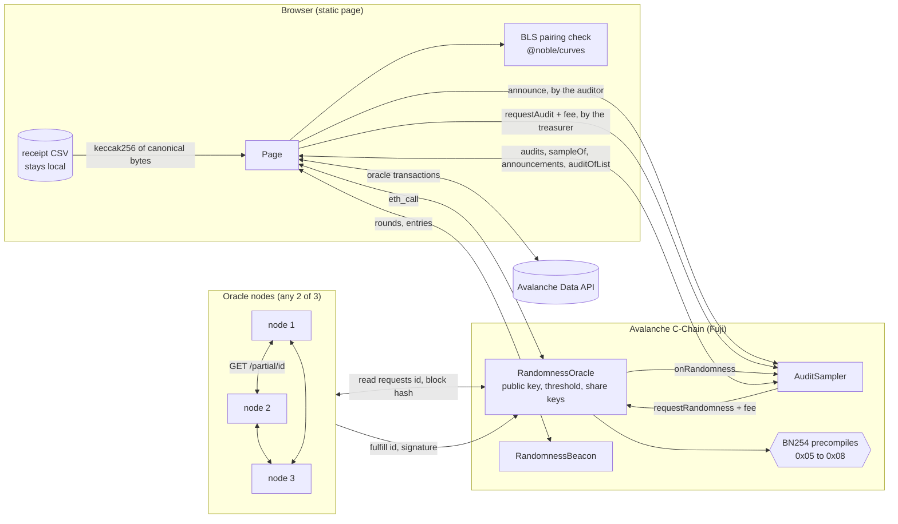
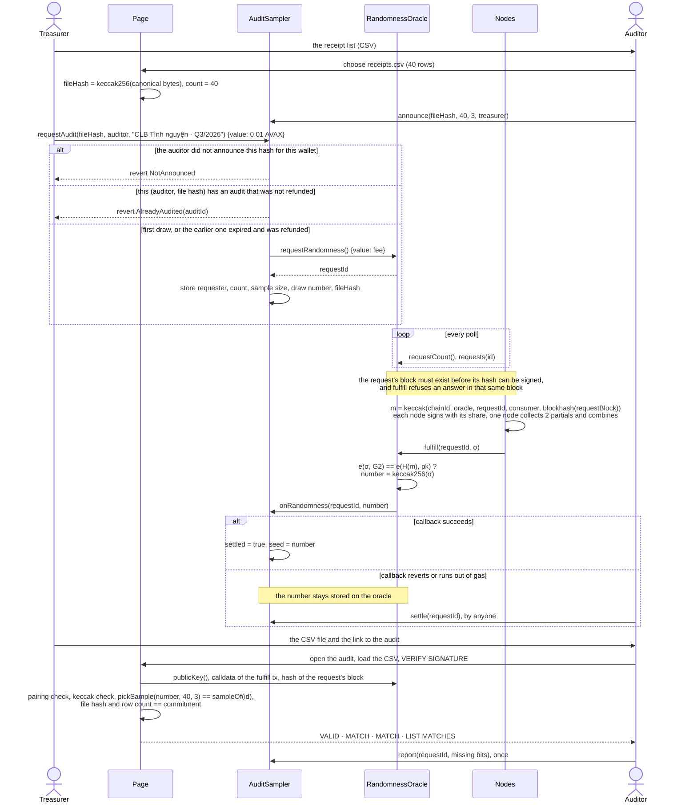
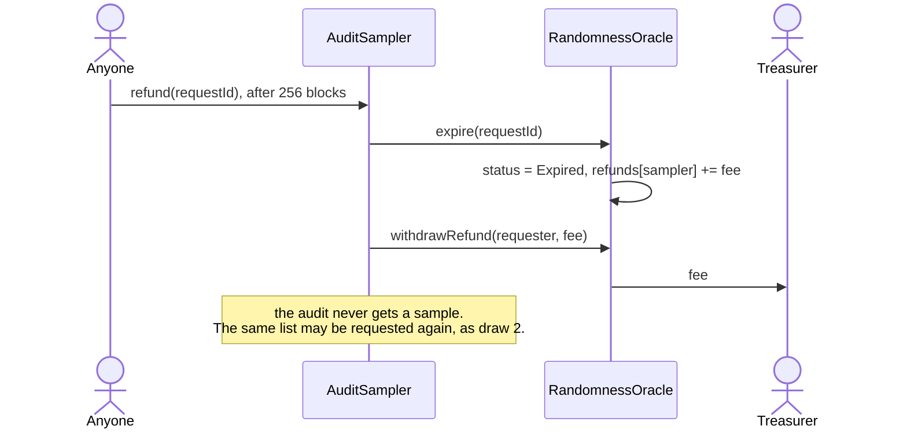
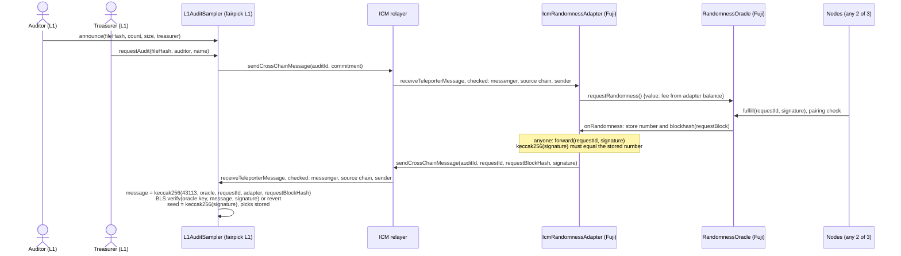
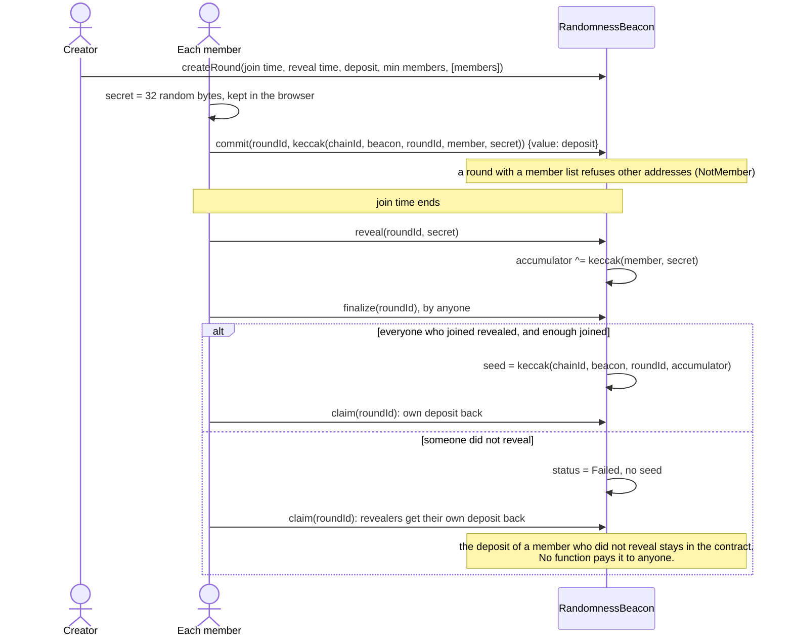
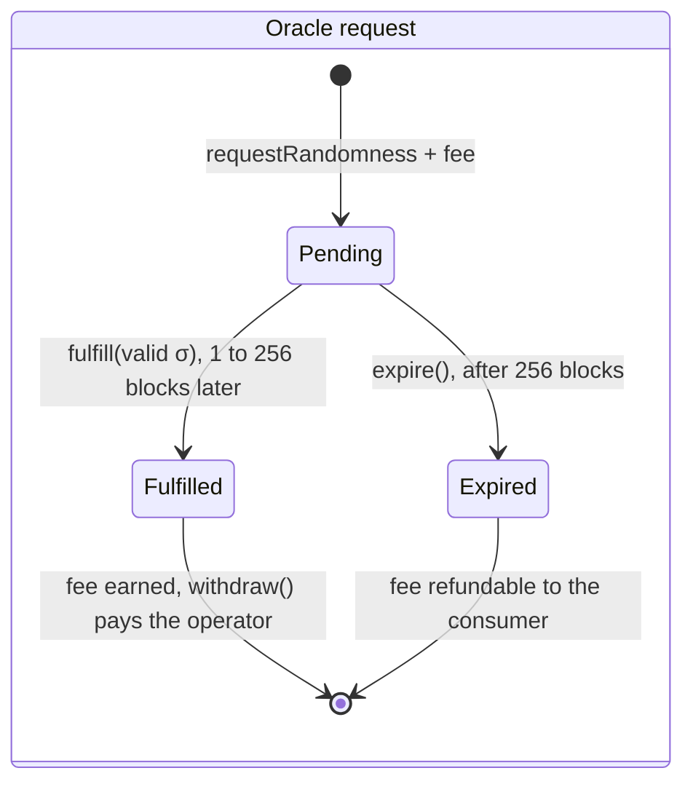
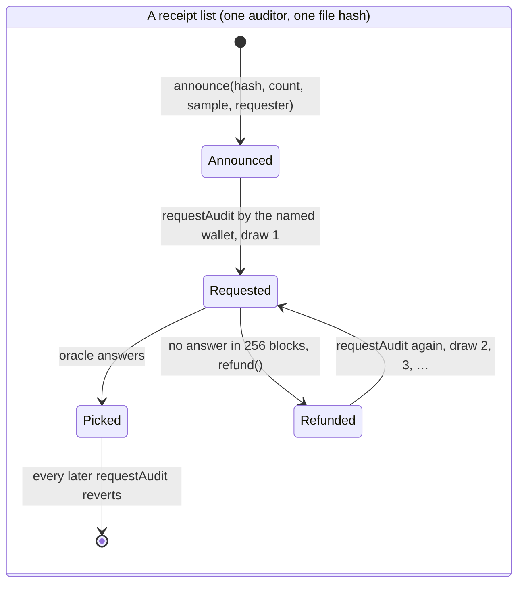
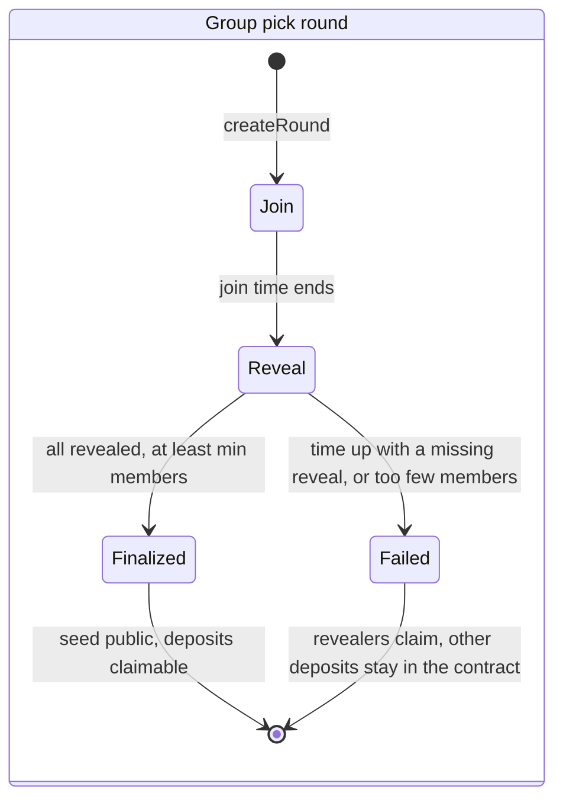

# Architecture

FairPick has three parts: three Solidity contracts on Avalanche, oracle nodes that sign requests off chain, and a static web page that reads the chain directly. There is no backend and no database. The page's only outside service is the Avalanche Data API, for reads, with plain RPC as the fallback.

On Fuji the oracle key is split 2 of 3 and three node processes run on one machine. The README says exactly [what runs there](../README.md#what-runs-on-fuji-exactly).

## System



| Part | Code | Notes |
|---|---|---|
| `RandomnessOracle` | `src/RandomnessOracle.sol`, `src/BLS.sol` | Flat fee, 256-block answer window, BLS verification through the pairing precompile, callback with 200,000 gas. Stores the threshold and the share public keys it was deployed with. One role, `operator`, which only receives fees. No owner, no key rotation. |
| `AuditSampler` | `src/AuditSampler.sol` | `announce`: the auditor stores the file hash, receipt count, sample size and the one wallet that may request. `requestAudit`: only that wallet, once per (auditor, file hash). Turns the oracle's number into distinct receipt numbers. `report`: the auditor records once which picked receipts were not found. |
| `L1AuditSampler` | `src/icm/L1AuditSampler.sol` | On the fairpick L1 (chainId 510103). Same announce and request rules as `AuditSampler`, no fee. The request leaves over ICM; the answer arrives over ICM with the oracle's BLS signature, which this contract checks with a pairing before storing the picks. |
| `IcmRandomnessAdapter` | `src/icm/IcmRandomnessAdapter.sol` | On Fuji, a consumer of `RandomnessOracle`. Files requests that arrive from the L1, pays the oracle fee from a prepaid balance, stores the answer and the request block's hash in its callback, and sends both with the signature back to the L1 (`forward`, open to anyone). |
| `RandomnessBeacon` | `src/RandomnessBeacon.sol` | Group pick with no node: commit-reveal with deposits, open or limited to listed members. |
| Node | `node/src` | Stateless: each start reads the requests still inside the 256-block window from contract state. Threshold BLS (Shamir split, Lagrange combine). Fee bumping with two spending caps. |
| Page | `dashboard/src` | React and viem. The BLS check runs in the browser and reuses the node's hashing code. `node/src/list.ts` is the one definition of the list hash, shared with the command line. |

## Audit flow



If nobody answers within 256 blocks:



The contract never redraws by itself. A new request after a refund is numbered `draw` 2, and the page shows "DRAW 2 OF 2" on it, because an expired draw can be an outage or a result somebody did not like.

## ICM flow (fairpick L1 and Fuji)

The audit office's own L1 has no oracle and should not trust its single validator's blockhash, so it uses the oracle on Fuji over ICM (TeleporterMessenger `0x253b…5fcf` on both chains, zero fee, the team's relayer). Addresses and transaction hashes: [README](../README.md#own-l1-fairpick-and-icm).



- Each receiver checks `msg.sender == messenger`, the source blockchainID and the origin sender. The remote address is set once by the deployer after both contracts exist, then fixed.
- The L1 does not take the adapter's word for the number: it re-checks the oracle's signature itself, on the exact message the nodes signed, using the oracle's public key stored at deployment. An adapter bug could still bind a valid answer to the wrong L1 audit; each oracle request settles at most one audit.
- A failed delivery (for example the adapter out of AVAX for the fee) reverts inside the messenger and is recorded as `MessageExecutionFailed`; Teleporter lets anyone retry it once the cause is fixed. A test covers that path with a mock messenger.
- Not covered: an oracle request that expires unanswered. The adapter can `reclaim` the fee, but the L1 is not told and its audit stays open.
- Who may write on the L1: since 21 Nov the TxAllowList precompile is on ([l1/](../l1/README.md)). The audit office (admin) enables treasurers and auditors; the relayer is enabled so answers arrive. Other wallets are refused by the node before their transaction reaches a block.
- The page's From L1 view reads only Fuji: the adapter's `requestOfRemoteAudit` and `pending`, its transactions through the Avalanche Data API, and the oracle's answer transactions. It ships the L1's record (`dashboard/src/l1-audits.json`, from `scripts/l1-export.sh`) and checks it: the commitment must equal what arrived over ICM, and the receipts must follow from the oracle's number.

## Group pick flow



## State







In the contract a round is `Open`, `Finalized` or `Failed`. Join and Reveal are the two time windows of `Open`.

## Data

| Where | What | Why there |
|---|---|---|
| Chain | file hash, receipt count, sample size, name (at most 64 bytes), requester, draw number, seed | Must be fixed before the pick and readable by anyone |
| Chain | oracle public key, threshold, share public keys | What an answer, and evidence about who signed it, is checked against |
| Chain | oracle requests, fees, refunds; group-pick commitments, deposits | Money and ordering rules |
| Browser `localStorage` | receipt CSV text by file hash; group-pick secrets before reveal | Personal or sensitive data stays off chain |
| Node disk | one key share and one wallet key per node (`.env.node1` to `3`) | Never in git |
| Avalanche Data API | nothing is stored there; the page asks it for the oracle's transactions | Finds request and answer transactions without scanning logs |

### The list hash

`fileHash = keccak256(canonical bytes)`. Canonical means: UTF-8, a leading byte-order mark removed, CRLF and lone CR turned into LF, trailing newlines removed. Nothing else is normalised. `itemCount` is the number of non-blank lines after the header, read by one CSV parser (`node/src/list.ts`) that accepts commas, semicolons or tabs and quoted fields. `commitment = keccak256(abi.encode(fileHash, itemCount))` exists both in the contract and in that file, and a test checks they agree on chain.

The page keeps the canonical text, so `DOWNLOAD CSV` returns exactly the hashed bytes. A file that fails to match gets one of two answers: "This file does not match the committed hash", or, when the bytes are right and the count is not, a count mismatch that says how many receipts could never be picked.

## The pick rule

```
for i in 0 .. sampleSize-1:
  for t in 0, 1, 2, ...:
    candidate = keccak256(abi.encode(seed, i, t)) mod itemCount + 1
    if candidate not yet picked: take it, next i
```

- `sampleSize` is at most 32 and `itemCount` at most 1,000,000.
- Each draw is off uniform by less than `itemCount / 2^256`, so a whole sample by less than `sampleSize × itemCount / 2^256`: under `2^-231` at the largest sizes allowed.
- `sampleOf` returns the receipts in the order they were drawn. The page sorts them for reading.
- The same rule exists as `AuditSampler.pick` (Solidity) and `pickSample` (TypeScript, `dashboard/src/derive.ts`). `dashboard/test/chain.test.ts` deploys the contracts on anvil and checks that the two agree.
- The group-pick page applies the same rule to a finalized round's seed to pick k members out of n.

## The key and its shares

The oracle is deployed with a public key, a threshold and, for a split key, the public key of every share. Its constructor refuses the shares unless:

- there are at least `threshold` of them, at most 16, and `threshold` is at least 2;
- each is a valid G2 point, none equals the public key, no two are equal;
- the public key and all share keys lie on one polynomial of degree `threshold - 1`, with the key at 0 and share *i* at *i*;
- `threshold - 1` shares do not already make up the key, so the declared threshold is the real one.

G2 has no arithmetic precompile on BN254, so each of these equations is checked inside a pairing: `e(l₁·G1, K₁) · … · e(lₜ·G1, Kₜ) · e(−G1, target) == 1` says `Σ lᵢ·Kᵢ == target` (`BLS.sharesMatchKey`). A single-signer deployment declares `threshold` 1 and no shares.

A node started with a key share reads the share keys from the contract and refuses to run if its share is not the one stored at its index.

### What partial-signature evidence proves

`docs/evidence/audit-N.json` holds the two partial signatures a node combined for one answer. `npm run check-partials` reads the public key, threshold and share keys from the contract, never from the file, and checks that each partial verifies under its share's key for the message the contract builds, that exactly `threshold` distinct shares are named, and that their combination is the signature in the answer's calldata.

The keys must come from the chain. From a public signature σ under key K, anyone can pick a number d, call `K + i·d·G2` "share i" and `σ + i·d·H(m)` "its partial", and get a file that is consistent with itself. A test builds exactly that forgery and checks that it fails against the deployed keys.

A pass shows the answer was assembled from signatures under two of the share keys fixed at deployment. It does not show that the shares sit on separate machines or with separate people, and it does not show that the full key no longer exists: the dealer who split it knew it, and a holder of one share plus the final signature can compute another share's partial. Only distributed key generation and operators you can name would close that.

## Security notes

What holds:
- Nobody can choose a result. A BLS signature is unique for a key and a message, and has one encoding the precompile accepts. The message includes the hash of the request's block, which nobody knew when the request was sent, and Avalanche does not reorganise accepted blocks.
- Only the wallet the auditor named can ask for a draw, and only for a list the auditor announced, with the announced count and sample size. A stranger who knows the hash is refused (`NotAnnounced`, on Fuji: tx `0x8b00740f…`), so nobody can use up a list's draw. Edited or re-ordered copies of a list need an announcement each, from the auditor.
- A list is drawn once. A second `requestAudit` for the same auditor and file hash reverts, also when the first draw's callback failed. Only a refunded draw frees the list, and the next one is numbered.
- The treasurer cannot swap the list after seeing the pick. The hash and count are stored by the auditor before the request is even sent.
- One share holder alone cannot produce the signature. On Fuji, node 1 running alone logged "1 of 2 partial signatures" until a second node started ([node1.log](evidence/logs/node1.log)).
- Callers cannot grief the callback. A `fulfill` sent with too little gas for the callback reverts as a whole (tested).
- The oracle never owes more than it holds. A Foundry invariant test checks that its balance always covers earned fees, pending fees and refunds.
- A node cannot be made to overspend. It never offers more than the oracle's fee in total for one answer, nor more than 500 gwei per gas (tested).
- A committee round with a member list cannot be joined, and so cannot be aborted, by an outsider.

What does not hold:
- Withholding. `threshold` share holders together learn a result before answering and can stay silent. The request expires, the fee is refunded, and the list can be requested again as draw 2. Nodes post no bond. On Fuji all shares are run by the team, on one machine.
- The key comes from a dealer. `keygen` creates the full key in memory and splits it.
- The announcement is only as good as the auditor. A treasurer may announce for themselves (the page shows NO SEPARATE AUDITOR), and a colluding auditor can announce several versions of a list. Each auditor's announcements are counted on chain (`announcedBy`) and shown.
- The receipt count is declared by the auditor. The page compares it with the file when the file is loaded. The contract cannot.
- The auditor's result (`report`) is the auditor's word. The contract stores it and checks only that it refers to picked receipts.
- The block producer of the request's block can vary its hash. To profit it must also know what each hash leads to, which takes `threshold` share holders.
- Cryptography and review. BN254 offers about 100-bit security, and the contracts are not audited.

Slither findings left on purpose:
- `RandomnessOracle._send` sends to a caller-chosen address: `withdrawRefund(to, amount)` pays out the caller's own credit.
- A strict equality on block age in `fulfill`: a same-block answer is refused on purpose.
- `AuditSampler.requestAudit` writes state after calling the oracle: the request id comes from the oracle, which is an immutable, trusted contract that calls nobody back during a request.
- Uninitialized locals `seen` in `pick` and `count` in `createRound` start at false and 0 by default.
- The beacon uses `block.timestamp` for windows measured in minutes.
